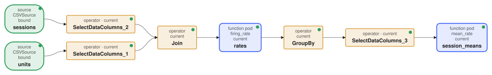

# Provenance: tracing a value

!!! warning "Provisional"
    `trace` and `why_missing` are provisional in 0.4.0. Their answers may be refined in a
    later release. A case they cannot prove is reported `unavailable` or refused with
    `ProvenanceInconsistencyError`, never guessed. Their known limits are listed under
    [Known limits](#known-limits). `diagram(highlight=...)` is in development: its
    interface and its look may change in any release.

A job keeps what it needs to answer "where did this value come from?" for every cell it
holds. `node.trace(row, column)` follows one cell back, step by step, to the source cells it
was made from. `node.why_missing(source, record_id)` says why a source row has no result. Both
only read: they never compute a function, call your code, poll a source or write to the
database.

```python
from orcapod import PipelineJob, function_pod
from orcapod.databases import InMemoryArrowDatabase
from orcapod.sources import DictSource

trials = DictSource(
    [
        {"animal": "a1", "trial": 1, "hits": 8, "misses": 2},
        {"animal": "a1", "trial": 2, "hits": 6, "misses": 4},
        {"animal": "a2", "trial": 1, "hits": 8, "misses": 2},
        {"animal": "a2", "trial": 2, "hits": 3, "misses": 7},
    ],
    tag_columns=["animal", "trial"],
    tag_only_columns=True,
    source_id="trials",
    record_id_columns=["animal", "trial"],
)


@function_pod(output_keys=["accuracy", "n"])
def score(hits: int, misses: int) -> tuple[float, int]:
    return hits / (hits + misses), hits + misses


@function_pod(output_keys="mean_accuracy")
def average(accuracy: list[float]) -> float:
    return sum(accuracy) / len(accuracy)


job = PipelineJob(name="behaviour", database=InMemoryArrowDatabase())
with job:
    scores = score.pod(trials, label="scores")
    average.pod(
        scores.group_by(["animal"]).select_data_columns(["accuracy"]),
        label="per_animal",
    )
job.run()

trace = job.nodes["per_animal"].trace({"animal": "a2"}, "mean_accuracy")
print(trace)
# trace of mean_accuracy at node per_animal, for animal='a2': 1 row matches
# per_animal (animal='a2'): mean_accuracy = 0.55
#   average v0.0 (body function_content_v1:...), computed here, computed ... on local, run ..., recorded ...
#   GroupBy (animal='a2'): accuracy = [0.8, 0.3]  (via SelectDataColumns)
#     [0] scores (animal='a2', trial=1): accuracy = 0.8
#       score v0.0 (body function_content_v1:...), reused a stored result, computed ... on local, run ..., recorded ...
#       dict_v1:trials {"animal":"a2","trial":1} hits = 8
#       dict_v1:trials {"animal":"a2","trial":1} misses = 2
#     [1] scores (animal='a2', trial=2): accuracy = 0.3
#       score v0.0 (body function_content_v1:...), computed here, computed ... on local, run ..., recorded ...
#       dict_v1:trials {"animal":"a2","trial":2} hits = 3
#       dict_v1:trials {"animal":"a2","trial":2} misses = 7
```

## What a trace reads

The `row` argument selects the held rows to trace, by column values (usually tags): every
row of the node whose columns equal them is traced, any number, and `{}` traces every
row. The `column` is one of its data columns. The trace's first line repeats the question
and says how many rows match (`trace of mean_accuracy at node per_animal, for
animal='a2': 1 row matches`). `trace.roots` holds one tree per matching row, in tag
order; `trace.root` is the one tree when exactly one row matches. A selector that matches
no held row gives a trace with status `no_match`; one that names a column the node does
not have raises `ValueError`. Each step of the trace is a `TraceStep`; it is found from
three records the job keeps.

- **The system tags of each row.** Every row carries hidden tags naming the source rows it
  came from (`as_table(columns={"system_tags": True})`). An operator that works row by row,
  and a function pod, keep them unchanged. A join keeps those of each input, under names
  extended with the input's place in the pipeline. So the input row of a row is the row
  of the input with the same system tags.
- **A function node's stored records.** For each input row a function node received, its
  pipeline record names that row (by its tags and system tags), the result it was served,
  and whether this row computed the result or reused one. The stored result says which
  function ran: its name, version and body hash, the executor, the Python version and the
  time. The trace shows these as a `FunctionRun`, and checks that the input row's content
  hash is the one the record stored.
- **The source-info tokens.** Each value carries `<source id>::<record id>::<column>`,
  which names the source cell it came from. A trace ends in `SourceCell`s.

A `GroupBy` or `Batch` folds its members' system tags into one digest, which cannot be
read backwards. The trace finds the members with the operator's own rule:

- for `GroupBy`, the input rows with the group's key, in member order;
- for `Batch`, the rows at the batch's position.

It then folds their system tags again; the result must equal the group's. If it does not,
the trace raises `ProvenanceInconsistencyError` and never guesses. Member `i` fills
position `i` of every list of the grouped row.

**Equal inputs, one result.** Trial 1 of `a1` and of `a2` have the same hits and misses, so
`score` ran once for the two and stored one result. The trace still follows each row to
its own source record. The `FunctionRun` of trial 1 of `a2` says it reused the stored
result (`computed_here` is `False`); that of `a1` says it computed it.

`trace.source_cells()` lists the source cells, each once; `trace.function_runs()` lists
every function step's `FunctionRun`. A trace of an operator node or of a source node works
the same way: on a source node it is one cell.

```python
for cell in trace.source_cells():
    print(cell.text())
# dict_v1:trials {"animal":"a2","trial":1} hits = 8
# dict_v1:trials {"animal":"a2","trial":1} misses = 2
# dict_v1:trials {"animal":"a2","trial":2} hits = 3
# dict_v1:trials {"animal":"a2","trial":2} misses = 7
print([(label, run.computed_here) for label, run in trace.function_runs()])
# [('per_animal', True), ('scores', False), ('scores', True)]
```

## When there is nothing to trace

An operator or function node shows only the rows of its run in this process (see
[Pipelines and Jobs](pipeline-job.md)). Before a run, and on a stale node, there is
nothing to trace, and the trace says so rather than computing. A source node is
different: when its source keeps its rows in memory, a trace of the source node reads
that snapshot, before a run too; any other source is reported `unavailable`. A function
node before a run:

```python
fresh = PipelineJob(name="behaviour", database=InMemoryArrowDatabase())
with fresh:
    fresh_scores = score.pod(trials, label="scores")
print(fresh.nodes["scores"].trace({"animal": "a1", "trial": 1}, "accuracy"))
# trace of accuracy at node scores, for animal='a1', trial=1: the node holds no rows to trace here
# scores: accuracy = None
#   not computed: run() the job first
```

A job loaded from its file (`PipelineJob.load`) traces the same once it has run with
`load_only=True`, which reads the stored results and computes nothing. The function steps
then show the same results, with the times they were computed.

## Why a row is missing

`why_missing(source, record_id)` takes a source, by its node's label, its name or its full
id as it appears in a source-info token (`dict_v1:trials`), and a record id. The source
argument must name exactly one source: when one source's name is another's id
(`dict_v1:a` names the source `a`, and a source named `dict_v1:a` too), it is refused
with `ValueError` naming both; give the node label or full id that names one. A node
label or source name asks about every id the slot's rows carry, a full id about that id
only; a slot whose label is also one of the several ids it carries is refused for that
string too. It reads the run the job holds: before a run, and on a loaded job not
yet run (`load_only=True`), it answers `not_computed`, even when the store holds entries.
It answers in two steps:

- **From the rows the nodes hold:** which nodes have a row from it, and which step removed
  it. The step is described in the words of `explain()`. For a join, the answer also gives
  the key the other input lacks.
- **From the stored records of the first function node on the way:** a stored entry
  of that node (this pipeline bound to these sources, in any of its runs) proves that a
  row from the record reached the function (`reached_function` is `True`). Entries
  stored under another binding of the pipeline are not read. No entry proves nothing: a function that raised on an
  input stores no entry for it. So `reached_function` is never `False`; `entry_recorded`
  says what the store holds.

```python
answer = job.nodes["per_animal"].why_missing("trials", '{"animal":"a3","trial":1}')
print(answer)
# why record {"animal":"a3","trial":1} of trials is missing at node per_animal
# trials {"animal":"a3","trial":1} does not reach per_animal: source 'trials' holds no record '{"animal":"a3","trial":1}'
#   no successful entry of function node 'scores' is stored for it (the function raised on it, or never received it)
```

The result is an `Absence`. Its fields hold:

- `missing`: whether the row is missing;
- `reached_function`, `entry_recorded` and `function_node`: the stored-record answer;
- `present_in`: the nodes that hold a row from the record;
- `removed_by`: the step that removed it, a `Step`;
- `because`: the reason, in words.

Tutorial [Part 8](../tutorial/08-inspecting-and-tracing.md) shows a row removed by a filter
and one removed by a join.

## On the diagram

`trace.highlight()` and `answer.highlight()` give a `Highlight`: the nodes and streams on
the path (for several rows, the union of their paths), with a note, the question written
out. `job.diagram(highlight=...)` outlines them in the text colour (which no node status
uses: red means failed), dims the rest, shows the note as a caption, and leaves out every
node's run status: it shows the provenance question only. The node the question was asked
at (`Highlight.asked`) gets a second outline and the line "traced from here" or "asked
here"; in the listing it is marked `>`.
A trace's highlight also marks each function node on the path with how its rows on the
path got their results (`Highlight.marks`): `computed`, `reused` (a result stored for equal
inputs) or `computed + reused` (some rows each). Its text listing marks the highlighted
nodes with `*` and a function node's mark in brackets; a mark of several rows is merged
per node. Here `scores` computed the score of
trial 2 of `a2` and reused the one stored for trial 1 (above):

```python
print(job.diagram(highlight=trace.highlight()))
# Job 'behaviour': 5 nodes
#   highlight (*): trace of mean_accuracy at node per_animal, for animal='a2': 1 row matches
#  * trials (source · DictSource)
#  * scores (function pod · score) [computed + reused] <- trials
#  * GroupBy (operator) <- scores
#  * SelectDataColumns (operator) <- GroupBy
# >* per_animal (function pod · average) [computed] [traced from here] <- SelectDataColumns
```

In a notebook the diagram is drawn as a picture, the mark as a bold line on its node. Here
is the job of tutorial [Part 8](../tutorial/08-inspecting-and-tracing.md), first plain,
then with the trace of one firing rate highlighted. Its path stops at `rates`: the grouping
after it is dimmed. That rate reused the result an equal input had computed, so `rates` is
marked `reused`:




A missing row's highlight ends at the step that removed it, and dims the rest. In the
tutorial's second job, a unit of `mouse_04` passes the filter on `probe` and is removed by
the Join, which has no session of `mouse_04` to match it with:


A `Highlight` can also be made by hand, from node labels, `(upstream, downstream)` label
pairs and `(label, mark)` pairs. A label the job does not have is refused with
`ValueError`.

## Known limits

- Job nodes only. A plain stream keeps no stored records, so it cannot be traced this way.
- A source is never read. A source cell is known from the token of the row read from
  it, with the value that row holds. Some sources keep their rows in memory: the
  in-memory, file and database sources, when their class does not change how they
  read. Their rows are also compared with what the run held, and a disagreement raises
  `ProvenanceInconsistencyError`. Other sources (cached, polling, derived and your own)
  are not read:
    - a step that needs their rows is reported with status `unavailable`, such as a
      `GroupBy` whose input is the source itself;
    - `why_missing` does not blame the first step after them, since it cannot tell
      whether the source holds the record.
- A link is never guessed. Two rows that cannot be told apart by their system tags,
  tokens and values are refused with `ProvenanceInconsistencyError`.
- Inputs of a commutative `Join` with one pipeline hash are told apart by the values
  they hold. Such inputs are two sources of one schema, or two upstream joins whose
  outputs share a pipeline hash. When two such upstream joins hold their sources in
  opposite orders, no assignment of the values fits, and the trace refuses the link
  rather than guess. `why_missing`'s stored answer through such tied inputs is unknown
  (`reached_function` is `None`), even when their source ids differ.
- The `row` argument compares values strictly: `False` never selects `0`, and a NaN
  key selects the NaN group.
- A node the trace passes must hold its run. After a full run every node does; after
  `node.run()` the nodes above it do.
- Only Orcapod's own operators are followed, each by its own rule (which input column
  each output column comes from). A subclass of an Orcapod operator, and an operator of
  your own, may do anything: `trace` reports their links `unavailable`, and
  `why_missing` past one answers `unavailable`.
- `why_missing` reads the run the job holds. With only stored entries (before a run, or
  on a loaded job not yet run with `load_only=True`) it answers `not_computed`.
- A `SemiJoin`'s right input only chooses which left rows pass. Its rows never reach the
  SemiJoin's output, and `why_missing` says so.
- The stored answer (`reached_function`) after a `GroupBy` or `Batch` is known only for
  the groups the run holds now; otherwise it is `None`.
- When a function recomputed a lost result, its stored entries are told apart by the
  run id that pipeline entries are to record (ITL-1433); until then the latest entry is
  shown.
